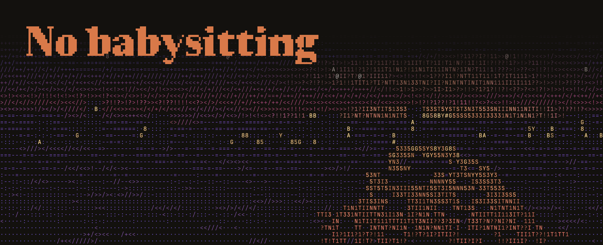
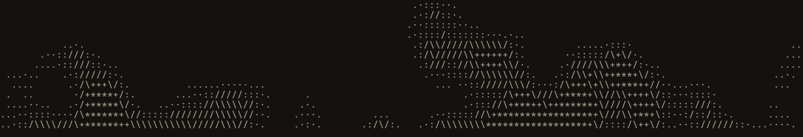

<p align="center">
  <a href="https://no-babysitting.github.io/no_babysitting_anymore/">
    
  </a>
</p>

<p align="center">
  <b>Từ vibe đến agentic.</b><br>
  Claude khôn hơn rồi, sao bạn vẫn phải trông trẻ?<br>
  <i>An unofficial, practical guide to delegating digital work to Claude Code.</i>
</p>

<p align="center">
  <a href="https://no-babysitting.github.io/no_babysitting_anymore/"><b>Vào trang học →</b></a> ·
  <a href="docs/README.md">Tài liệu</a> ·
  <a href="CHANGELOG.md">Thay đổi</a> ·
  <a href="https://github.com/no-babysitting/no_babysitting_anymore/issues">Góp ý, báo sai</a>
</p>

---

## Trang này dạy gì

**Thôi cầm tay chỉ việc: cùng Claude làm rõ việc, rồi giao trọn cho nó.**

No Babysitting là trang học tiếng Việt, miễn phí, cho người đi làm ở mọi vai, không cần biết code. Nội dung chính là *six shifts*, sáu điều Anthropic rút ra khi xoá hơn 80% chỉ dẫn hệ thống của Claude Code mà không đo được sụt giảm nào trên các bài đánh giá về code. Phương pháp đi kèm là bài *Finding your unknowns*: tìm điều chưa biết trước, trong và sau khi làm.

| | Track | Gồm | Trạng thái |
|---|---|---|---|
| 🌱 | **Nhập môn** | Tạo dự án đầu tiên, Claude tự lo gì và bạn lo gì, model và effort, đồ nghề, lệnh hay dùng, thuật ngữ | Đang lên kế hoạch |
| ⟶ | **Lộ trình chính** · khoảng 25 phút | 00 Vì sao bạn vẫn phải trông · 01 **Trước:** tìm điều chưa biết · 02 **Trước:** giao việc · 03 **Trong:** để nó làm · 04 **Sau:** kiểm, hỏi vặn, rồi buông | Kịch bản đã duyệt, đang dựng |
| ◆ | **Nâng cao** | CLAUDE.md, skill, subagent, model và effort, quyền và hook, lịch chạy, design system | Viết sau |

Mỗi ví dụ đổi theo **nhóm việc** của bạn: vận hành, marketing, nghiên cứu, dữ liệu, dựng sản phẩm, sáng tạo, thiết kế, bán hàng, phân tích yêu cầu.

<p align="center">
  
</p>

## Thiết kế

*Terminal brutalism × cinematic ASCII.* Logo khối, ASCII địa hình và mặt nước trôi chậm, cảnh thành phố lúc hoàng hôn ở cuối trang, mascot `[•_•]` (đồng nghiệp AI) và chuyển động có ngữ pháp riêng. Có nút tắt chuyển động. Typography, độ tương phản và gu trình bày được đo tự động trong CI.

| | |
|---|---|
| Design system | [`design-system/`](design-system/) · [`SOURCE-OF-TRUTH.md`](design-system/SOURCE-OF-TRUTH.md) |
| Chuyển động | [`docs/09-motion-script.md`](docs/09-motion-script.md) · [`docs/15-typography-motion-v4.md`](docs/15-typography-motion-v4.md) |
| Typography và gu trình bày | [`docs/11-typography.md`](docs/11-typography.md) · [`docs/13-design-taste.md`](docs/13-design-taste.md) |

Ảnh ở đầu README và GIF mặt nước được dựng bằng chính runtime ASCII của trang (`tools/readme-art.cjs`).

## Tài liệu chính

| Tài liệu | Nội dung |
|---|---|
| [`14-content-script-v4.md`](docs/14-content-script-v4.md) | Kịch bản nội dung: kim tự tháp, trang chủ, 5 phần, kính theo nhóm việc |
| [`16-writing-guide.md`](docs/16-writing-guide.md) | Văn phong tiếng Việt và tiếng Anh |
| [`17-handoff-prompt.md`](docs/17-handoff-prompt.md) | Prompt giao cho coding agent, kèm nguồn chính thức |
| [`18-intro-track-plan.md`](docs/18-intro-track-plan.md) | Kế hoạch track Nhập môn |
| [`19-uiux-kaizen-plan.md`](docs/19-uiux-kaizen-plan.md) | Kaizen UI/UX, khoá ASCII art |
| [`20-handoff-prompt-deepseek.md`](docs/20-handoff-prompt-deepseek.md) | Prompt cho coding agent DeepSeek |
| [`08-kaizen-go-live.md`](docs/08-kaizen-go-live.md) | Quyết định của chủ dự án, quy tắc phát hành |

Mục lục đầy đủ và README cũ: [`docs/README.md`](docs/README.md).

## Chạy local

```bash
cd site
npm ci
NB_BASE=/no_babysitting_anymore/ npm run build
NB_BASE=/no_babysitting_anymore/ node scripts/check.cjs        # link, lỗi JS, cuộn ngang, reduced motion
NB_BASE=/no_babysitting_anymore/ node scripts/type-check.cjs   # typography
NB_BASE=/no_babysitting_anymore/ node scripts/design-check.cjs # gu trình bày
NB_BASE=/no_babysitting_anymore/ node scripts/art-check.cjs    # ASCII art đã duyệt không bị đổi
```

Mỗi thay đổi là một PR (quy tắc cho agent: `AGENTS.md`). Merge vào `main` thì GitHub Pages tự cập nhật. Câu chữ mới trên trang cần chủ dự án duyệt trước khi merge.

## Giấy phép và ghi công

- Code: MIT ([`LICENSE`](LICENSE)). Nội dung: CC BY-NC-SA 4.0 ([`LICENSE-CONTENT.md`](LICENSE-CONTENT.md)). Bên thứ ba: [`THIRD_PARTY_NOTICES.md`](THIRD_PARTY_NOTICES.md).
- Nguồn chính: tài liệu và blog chính thức của Anthropic; repo cộng đồng [shanraisshan/claude-code-best-practice](https://github.com/shanraisshan/claude-code-best-practice) (MIT).
- Duy trì bởi [taiseixx](https://github.com/taiseixx).

<sub>No Babysitting là dự án cộng đồng độc lập, không liên kết, không được tài trợ hay xác nhận bởi Anthropic. Claude và Claude Code là thương hiệu của Anthropic.</sub>
